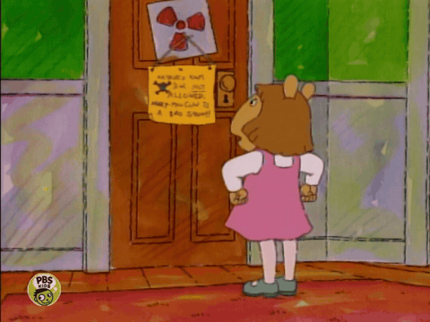
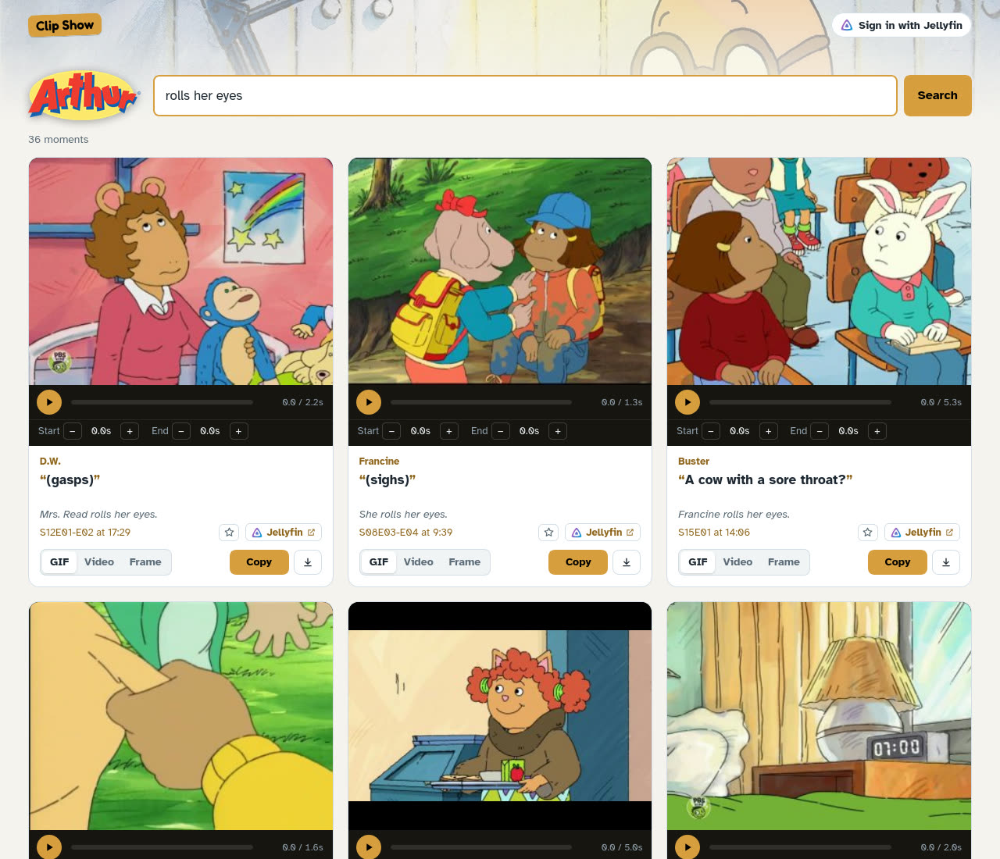
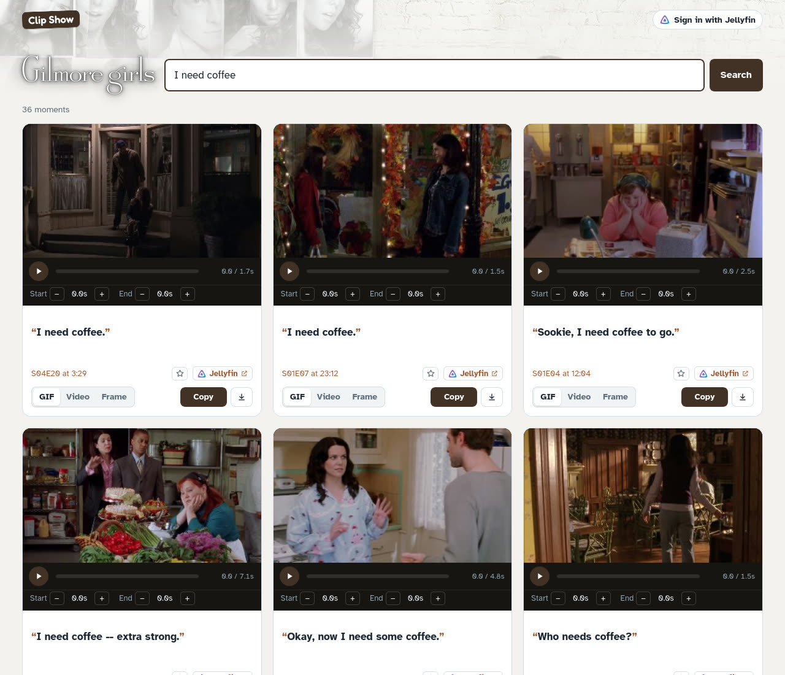

# Clip Show

**Turn your media library into a meme machine.**

Somebody on your favorite show has already made the exact face you're making right now. Clip Show
finds them. Type a line you half-remember, or just a feeling (*nope*, *slow clap*, *rolls her eyes*,
*lol*), and get the moment from your own [Jellyfin](https://jellyfin.org) library, trimmed and ready to
post as a **GIF**, a **video clip**, or a **captioned still**.

<p align="center"></p>

- **Search by quote or by feeling.** Exact lines, things that *mean* the same, and reactions people
  actually post: short exclamations, gasps, groans, laughter.
- **Clips that start and end in the right place.** Moments are trimmed to when people actually speak,
  with the beat afterwards (where the reaction lives), cut on shot changes.
- **Every show gets its own look,** themed from its Jellyfin artwork.
- **Sign in with Jellyfin** (optional) to open any moment in Jellyfin right where it happens, and to
  keep favorites that follow you between devices.

### Made with Clip Show

<table>
  <tr>
    <td width="50%"></td>
    <td width="50%"></td>
  </tr>
  <tr>
    <td>Search: <i>go on the internet and tell lies</i></td>
    <td>Search: <i>that sign can't stop me i can't read</td>
  </tr>
</table>

Each show takes on its own colors and logo. Searching Arthur for a feeling, and Gilmore Girls for a line:





## What you need

- A **Jellyfin** server with some TV shows or movies.
- **Subtitles** for them: `.srt` files next to the videos, or subtitles/closed captions inside the
  files. (Picture-based subtitles from DVDs and Blu-rays aren't supported yet.) Clip Show reads the
  words to know what's being said, so episodes without subtitles are skipped. SHOUTY ALL-CAPS captions
  are fine: they're shown (and burned into GIFs) in normal sentence case.
- **Docker** (or Podman) on a machine that can see your media files.
- Some disk space: a few GB per show, plus room for clips (2 GB by default).

A graphics card helps indexing go faster but isn't required. See [Hardware & speed](#hardware--speed).

## Getting started

1. Grab [`compose.yaml`](compose.yaml) and [`.env.example`](.env.example), rename the latter to `.env`,
   and fill in your Jellyfin address, the folder that holds your media, and a worker token
   (any long random string; `openssl rand -hex 32` makes a good one).
2. Start it:
   ```sh
   docker compose up -d
   ```
3. Open `http://<your server>:8000` and **Sign in with Jellyfin** using an administrator account.
4. Go to **Manage**:
   - Under **Folders**, tell Clip Show where it finds each of your Jellyfin libraries (inside the
     container your media is at `/media`, so for example `/mnt/pool/media/TV` becomes `/media/TV`).
   - Under **Add from Jellyfin**, open a library and press **Add** on a show.
5. The worker starts indexing straight away; progress shows up in **Manage**. Episodes become
   searchable as they finish.

Two containers make up Clip Show: **web** (the site, search, and clip-making; light, CPU only) and
**worker** (indexing; this is where a GPU helps). The worker talks to the web app over the network, so
it can just as well run on another machine; see [Indexing on another machine](#indexing-on-another-machine).

## How search works

Clip Show cuts every episode into **moments**: usually one line of dialogue, from just before the voice
starts to just after it stops, plus the pause that follows. Quiet stretches become moments too. For each
one it knows:

- **The words**, from the subtitles. Exact quotes match first. *"I knew you'd chicken out"* finds that
  line; quote two lines in a row and you get one clip covering both.
- **What the words mean.** *"I'm in shock that you did this"* finds *"I can't believe you did that."*
- **Sounds** that captions describe: *(gasps)*, *(laughing)*, *(groans)*. So *lol* finds laughter,
  *omg* finds gasps, and *ugh* finds groans and sighs.
- **Who's talking and what's happening**, if you have transcripts. Put `Episode Name.transcript.txt`
  next to the video, with lines like `Lorelai: Coffee?` and stage directions in `[brackets]`; Clip Show
  lines them up with the subtitles. Then *Lorelai coffee* finds Lorelai, and *rolls her eyes* finds the
  eye-rolls themselves.

Results lean towards moments that work as a reaction on their own: short, punchy, a face or a gasp
rather than a minute of plot.

## Hardware & speed

**Searching** is quick on any computer: tens of milliseconds for a show with 150,000 moments.

**Indexing** is the heavy part, and it happens once per episode. Each episode is decoded a single time,
to find shot changes and keep small frames; the audio is scanned for voices; then the lines are
embedded for meaning-based search. As a rough guide from a 16-core desktop:

| Show | Per episode, per worker | Notes |
|---|---|---|
| Half-hour cartoon, 480p | about 1–2 minutes | |
| Hour-long drama, 1080p | about 3–4 minutes | decoding HD is most of the work |

Several episodes are indexed at once (`CLIPSHOW_WORKERS`), so a whole season usually takes well under
an hour. The worker comes in three flavors:

| Image | For |
|---|---|
| `ghcr.io/ryanhecht/clipshow-worker:cpu` | any machine |
| `ghcr.io/ryanhecht/clipshow-worker:cuda` | NVIDIA graphics cards |
| `ghcr.io/ryanhecht/clipshow-worker:rocm` | AMD graphics cards |

Whatever the flavor, passing your graphics card's `/dev/dri` into the worker lets AMD and Intel GPUs
decode the video, which takes the biggest load off the processor. `compose.yaml` has the lines for each.

### Indexing on another machine

The worker doesn't need the web app's disk, only its address and the worker token, plus its own view of
your media. So you can keep the site on your always-on server and index on the desktop with the
graphics card:

1. On the server, run `compose.yaml` but remove its `worker` service (or leave it, and both share the work).
2. On the other machine, mount the same media at `/media` and run [`compose.worker.yaml`](compose.worker.yaml)
   with `CLIPSHOW_SERVER` pointing at the web app and the same `WORKER_TOKEN`.

Workers pick up queued shows automatically and send each finished episode back. Run as many as you like.

**Disk:** expect roughly 2–3 GB per 150 hour-long episodes for the index and thumbnails. Made clips are
kept for reuse up to a limit you set (2 GB by default); the least recently used go first, and favorites
are never removed.

## Sharing links publicly

Copy and the 🔗 button make **share links**: `https://…/s/<random>.gif` (or `.mp4`, `.png`). A share link
opens without signing in, and chat apps show it as a GIF or video. Each shared file is made once and kept
until an admin takes the link down in **Manage**, so strangers can only see what someone chose to share.

Clip Show can stay private while its share links are public. The web app answers share links on a
second port that serves **only** shared files: no search, no admin, nothing else. Publish just that port,
then enter its public address in **Manage → Settings → Public address for share links** (or set
`SHARE_URL`).

With [Tailscale](https://tailscale.com), for example, people on your tailnet use the app over HTTPS
and everyone else can only open share links:

```sh
tailscale serve --bg http://127.0.0.1:8000                    # the app, on your tailnet only
tailscale funnel --bg --https=8443 http://127.0.0.1:8001      # share links, public
```

The public address is then `https://<machine>.<tailnet>.ts.net:8443`. A Cloudflare Tunnel or a reverse
proxy pointed at port 8001 works the same way. By default only people signed in with Jellyfin can make
share links; you can change that in **Manage**.

## Settings

Set these in `.env` (most can also be changed later in **Manage**):

| Setting | What it does |
|---|---|
| `JELLYFIN_URL` | **Required.** Your Jellyfin server. It can only be set here, on purpose, so nobody can point a fresh install at a server they control. |
| `JELLYFIN_PUBLIC_URL` | How people's browsers reach Jellyfin, for "Open in Jellyfin", if different. |
| `CLIPSHOW_SIGNIN` | `optional` (anyone can search; signing in adds Jellyfin features) or `required`. |
| `CLIPSHOW_RENDER_CACHE_MB` | Space for made clips, GIFs and stills (default 2048). |
| `CLIPSHOW_PREFETCH` | How many top results to start making as soon as a search runs, so they play instantly (default 6). |
| `CLIPSHOW_FAVORITES_USER` / `CLIPSHOW_FAVORITES_BROWSER` | Favorites per Jellyfin account (default 500) and per signed-out browser (default 100). 0 turns them off. |
| `SHARE_PORT` | The port that serves share links and nothing else (default 8001). See [Sharing links publicly](#sharing-links-publicly). |
| `SHARE_URL` | The public address of that port, for share links. Empty: links use the address you opened Clip Show at. |
| `CLIPSHOW_SHARE_LINKS` | Who can make share links: `everyone`, `signed_in` (default) or `off`. |
| `WORKER_TOKEN` | **Required.** A shared secret between the web app and its workers (`CLIPSHOW_WORKER_TOKEN` inside the containers). |
| `CLIPSHOW_WORKERS` | Episodes a worker indexes at once (default 4). |

## Using clips responsibly

Clip Show is for media you have the right to use. It works on your own library and makes clips for
you; what you share, and where, is up to you, the same as screenshots or clips made any other way.
If you put Clip Show on the open internet, consider requiring sign-in so it stays among the people
who already use your Jellyfin, or keep it private and publish only [share links](#sharing-links-publicly).
Admins can see every share link in **Manage** and take any of them down.

## Running from source

Pick the PyTorch flavor for your hardware (`cpu`, `cuda` for NVIDIA, or `rocm` for AMD) and pass the
same `--extra` to every `uv` command, so uv doesn't swap it out:

```sh
uv sync --extra cpu
export CLIPSHOW_WORKER_TOKEN=dev-token
JELLYFIN_URL=http://localhost:8096 uv run --extra cpu clipshow-web
uv run --extra cpu clipshow-worker --server http://localhost:8000
```

`uv run --extra cpu clipshow --help` lists admin and debugging commands. [docs/architecture.md](docs/architecture.md)
describes how the pieces fit together.

## Credits

Clip Show works with [Jellyfin](https://jellyfin.org) but isn't part of the Jellyfin project. The
Jellyfin logo (`src/clipshow/web/static/jellyfin.svg`, unmodified) is © the Jellyfin contributors,
licensed [CC BY-SA 4.0](https://creativecommons.org/licenses/by-sa/4.0/), and is used only to label
Jellyfin sign-in and links.

Clip Show is released under the [MIT License](LICENSE).
